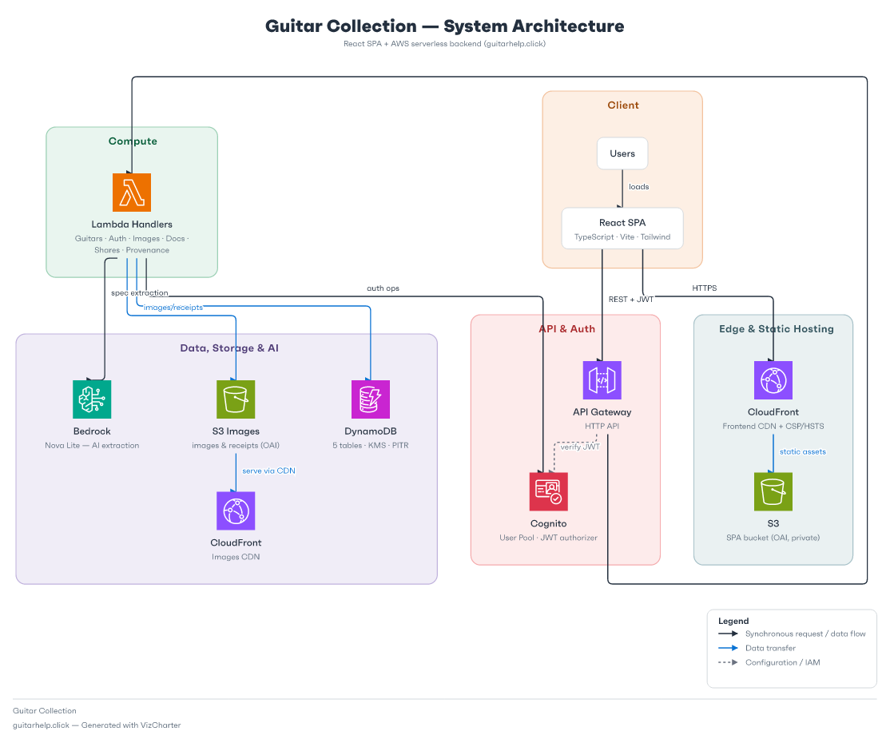

# Guitar Collection Manager

[](https://github.com/onemorepereira/guitar-collection/actions/workflows/ci.yml)
[](LICENSE)

A full-stack web app for cataloging a guitar collection: specs, photos, documents, condition, and provenance. It runs on AWS serverless (Lambda, DynamoDB, Cognito, S3, Bedrock) with a React + TypeScript frontend.

**Try it:** https://guitarhelp.click

## Features

- **Catalog**: brand, model, year, detailed specs, private purchase/value info, and a notes journal per guitar.
- **Spec autocomplete**: fuzzy model matching fills in known specs for hundreds of models (runs locally with fuse.js).
- **AI import**: extract specs from a PDF, product page text, or receipt with Amazon Bedrock Nova Lite, then review where each value came from in the source.
- **Photos**: multiple images per guitar, uploaded directly to S3 and served through CloudFront.
- **Documents**: store receipts, manuals, and certificates, and link them to guitars. Text and image descriptions are extracted in the background (Textract + Nova Lite).
- **Condition reports**: mark scratches, dings, and repairs on front/back body diagrams (10 body shapes) to get a condition score.
- **Provenance reports**: AI-generated authenticity/history reports (Nova Pro).
- **Share links**: public `/s/<id>` pages with per-field visibility and watermarked photos.
- **Filters and search**: filter by brand, type, and year; dark mode.

## Architecture



The React SPA is served from S3 through CloudFront. It calls an API Gateway HTTP API protected by a Cognito JWT authorizer, which routes to per-domain Lambda functions (Node.js 22) backed by DynamoDB, an S3 images bucket with its own CDN, and Amazon Bedrock. Everything is defined as code: [`backend/template.yaml`](backend/template.yaml) (AWS SAM) and [`frontend-infrastructure.yaml`](frontend-infrastructure.yaml). Details are in [docs/ARCHITECTURE.md](docs/ARCHITECTURE.md).

**Stack:** React 18, TypeScript, Vite, Tailwind CSS, React Router · AWS Lambda, API Gateway (HTTP API), DynamoDB, Cognito, S3, CloudFront, SQS/SNS, Textract, Bedrock · AWS SAM, CloudFormation, GitHub Actions

## Quick start

### Run the frontend locally

```bash
make install   # frontend + backend/src dependencies
make dev       # http://localhost:5173 — needs VITE_API_URL in .env pointing at a deployed non-prod API
npm test       # frontend tests; backend: cd backend && npm install && npm test
```

See [docs/DEVELOPMENT.md](docs/DEVELOPMENT.md) for local setup against a dev stack, tests, and common changes.

### Deploy your own copy

Prerequisites: an AWS account, a domain in a Route 53 hosted zone, Bedrock access to Nova Lite/Pro, Node.js 22+, AWS CLI, SAM CLI, jq.

```bash
make init        # creates .env.deploy and backend/samconfig.toml from the examples
# edit both files: account, region, domain, hosted zone ID, stack names (see docs/DEPLOYMENT.md#configuration)
make install
make deploy-all  # backend → frontend infrastructure → frontend app
```

See [docs/DEPLOYMENT.md](docs/DEPLOYMENT.md) for configuration, every `make` target, verification, teardown, and troubleshooting.

## Documentation

| Doc | For |
|-----|-----|
| [docs/ARCHITECTURE.md](docs/ARCHITECTURE.md) | How it works: components, data model, flows, security controls and known gaps |
| [docs/DEPLOYMENT.md](docs/DEPLOYMENT.md) | Deploying, operating, and tearing down your own copy |
| [docs/DEVELOPMENT.md](docs/DEVELOPMENT.md) | Local setup, tests, project layout, common changes |
| [docs/API_CONTRACT.md](docs/API_CONTRACT.md) | Endpoints and data shapes |
| [docs/CONTRIBUTING.md](docs/CONTRIBUTING.md) | How to contribute |
| [SECURITY.md](SECURITY.md) | Reporting a vulnerability |

## Contributing

Issues and pull requests are welcome; see [docs/CONTRIBUTING.md](docs/CONTRIBUTING.md). Please report security issues privately as described in [SECURITY.md](SECURITY.md).

## License

[MIT](LICENSE) © 2025 Miguel Pereira
