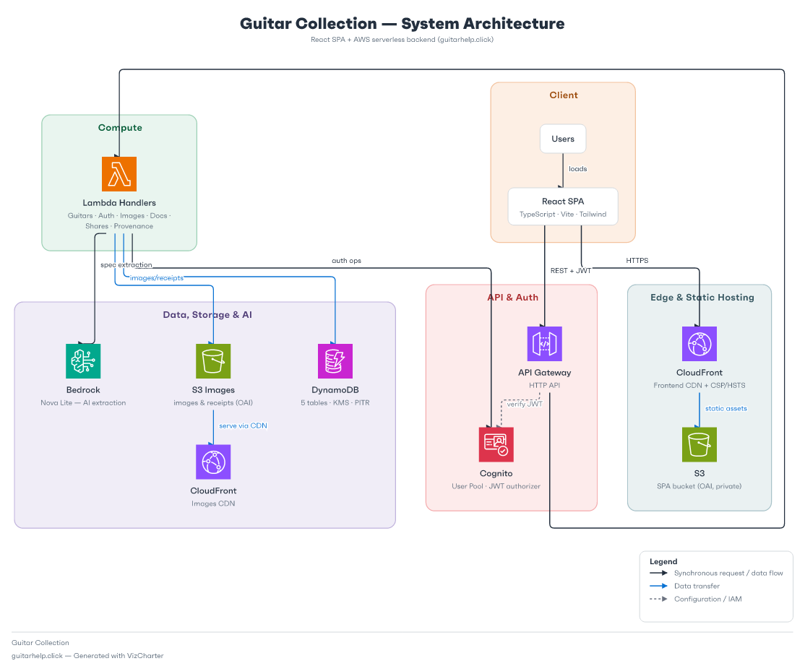
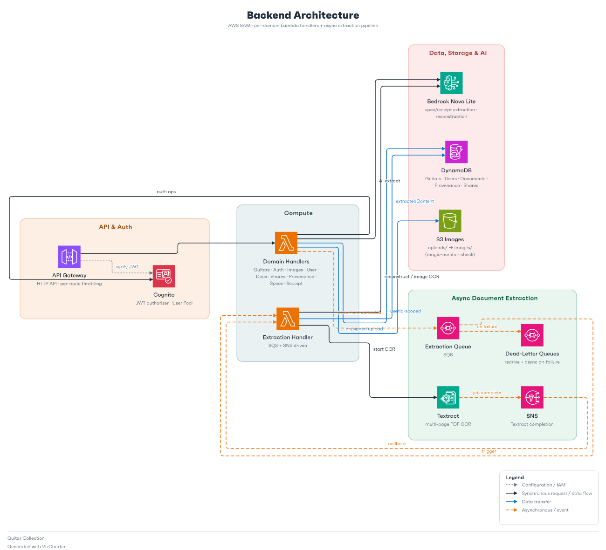

# Architecture

How the Guitar Collection app is put together: a React single-page app served from CloudFront, and a serverless backend defined in one AWS SAM template.

- Frontend infrastructure: [`frontend-infrastructure.yaml`](../frontend-infrastructure.yaml)
- Backend infrastructure: [`backend/template.yaml`](../backend/template.yaml), the source of truth for every resource, route, limit, and IAM policy described here
- API routes and data shapes: [API_CONTRACT.md](API_CONTRACT.md)

> The SPA is served from S3 through CloudFront. API calls go to an API Gateway HTTP API with a Cognito JWT authorizer, then to per-domain Lambda handlers that use DynamoDB, an S3 images bucket behind its own CloudFront distribution, and Amazon Bedrock.

---

## Frontend (`src/`)

| Concern | Where |
|---------|-------|
| Stack | Vite, React 18, TypeScript, Tailwind CSS, React Router v6 |
| Routes | `src/App.tsx`. Public: `/`, `/login`, `/s/:shareId` (shared guitar). Everything else is wrapped in `ProtectedRoute` |
| State | `ThemeContext` (dark mode) wraps `AuthContext`, which wraps the router |
| API access | One module per domain in `src/services/` (`guitarService`, `documentService`, `shareService`, `provenanceService`, `authService`). Components never call `fetch` directly |
| HTTP wrapper | `src/utils/api.ts` prefixes `VITE_API_URL`, attaches the JWT, and adds the `X-Requested-With` CSRF header |
| Spec autocomplete | `src/hooks/useGuitarSuggestions.ts` + `src/data/guitarKnowledge.json`, fuzzy-matched with fuse.js (runs locally, no AI call) |
| Condition diagrams | `src/components/condition/`: SVG body-shape templates with percentage-positioned blemish markers |

Only `VITE_API_URL` is read at build time; it is baked into the bundle.

---

## Backend (`backend/`)

> Per-domain Lambda handlers behind the HTTP API and Cognito authorizer, plus the async document-extraction pipeline (SQS → Textract/Bedrock → DynamoDB) with dead-letter queues. Provenance reports use Bedrock Nova Pro; the other AI features use Nova Lite.

### API

- **API Gateway HTTP API** with one stage named after the `Environment` parameter (`dev`, `staging`, or `prod`).
- **Auth**: a native Cognito **JWT authorizer** (not a Lambda authorizer) validates `Authorization: Bearer <idToken>` on every route except `/auth/*` and `/public/*`.
- **Throttling**: 100 req/s (burst 200) by default, with tighter per-route limits:

  | Route | Rate / burst |
  |-------|-------------|
  | `POST /auth/login` | 2/s, 10 |
  | `POST /auth/register` | 1/s, 5 |
  | `POST /auth/forgot-password` | 1/s, 3 |
  | `POST /specs/extract` | 2/s, 10 |
  | `GET /public/guitars/random` | 1/s, 10 |
  | `GET /public/shares/{shareId}` | 5/s, 20 |
  | `POST /user/export` | 1/s, 3 |
  | `POST /user/deletion` | 1/s, 3 |

- **Custom domain** (optional): when the `HostedZoneId` parameter is set, the stack creates an ACM certificate, the API domain mapping, and Route 53 records for the API and images domains.

### Lambda functions

All run Node.js 22.x (`nodejs22.x`) with a 10 s / 512 MB default. Function names are `${StackName}-<suffix>`.

| Function | Suffix | Handles | Notes |
|----------|--------|---------|-------|
| AuthHandler | `auth` | register, login, refresh, forgot/reset password | Wraps Cognito |
| GuitarsHandler | `guitars` | guitar CRUD, brand list | |
| PublicGuitarHandler | `public-guitar` | random **opted-in** guitar for the landing page | Only `showInGallery = true`; strips private fields and image captions |
| ImagesHandler | `images` | presigned upload URL, upload completion | |
| UserHandler | `user` | profile, display name, start/status of a data export, account deletion request | Re-verifies the password for export and deletion |
| SpecsHandler | `specs` | AI spec extraction from PDF/text | 60 s, 1024 MB, Nova Lite |
| ReceiptHandler | `receipts` | AI receipt extraction | 60 s, 1024 MB, Nova Lite |
| DocumentsHandler | `documents` | document CRUD, assign to guitars, queue extraction | |
| DocumentExtractionHandler | `document-extraction` | async content extraction (SQS + SNS triggered) | 300 s, 1024 MB, Textract + Nova Lite |
| ProvenanceHandler | `provenance` | AI provenance reports | 60 s, Nova Pro |
| SharesHandler | `shares` | share links, public share view | 30 s, 1024 MB, `sharp` layer for watermarked images |
| AccountJobsHandler | `account-jobs` | export ZIP builds, account deletion, 15-minute sweeper (SQS + schedule) | 900 s, 3008 MB |
| LogRetentionHandler | `log-retention` | CloudFormation custom resource: 90-day retention on every function's log group | Deploy-time only |

**Routing pattern.** Each domain has a `handlers/<domain>/index.js` that strips the stage prefix from `rawPath`, matches path + method, and dispatches to one file per operation (`list.js`, `create.js`, …). A new endpoint means a route event in `template.yaml`, a match in `index.js`, and an operation file.

**Shared library** (`backend/src/lib/`): `response.js` (response helpers), `validation.js` (field whitelist and format checks), `sanitization.js` (recursive HTML stripping), `inputLimits.js` (10 MB uploads, 50,000-char text), `fileValidation.js` (magic-number checks), `csrf.js`, `cognito.js` (Cognito calls, JWKS verification, password re-check, deletion tombstone check), `audit.js` (security-event logging), `accountJobs.js` (deletion tombstones and export jobs), `accountQueue.js`, `cdn.js` (CloudFront invalidation), `dynamodb.js`, `s3.js`, `s3Keys.js`, `bedrock.js`, `logger.js`, `errors.js` (incl. `CodedError`, whose `code` always reaches the client). All AWS access uses the modular AWS SDK v3 clients.

**Dependencies.** SAM builds each function with `BuildMethod: makefile`, which copies `backend/src/` as-is. Runtime dependencies must be declared in **`backend/src/package.json`** and installed (`make install`) before `sam build`. `backend/package.json` holds only test tooling.

### Data (DynamoDB)

Six tables, named `${StackName}-<name>`, all with server-side encryption using the AWS-managed KMS key (`SSEType: KMS`).

| Table | Partition key | Sort key | GSIs |
|-------|---------------|----------|------|
| `guitars` | `userId` | `guitarId` | `brand-userId-index` (`brand`, `userId`) |
| `users` | `userId` | — | — |
| `documents` | `userId` | `documentId` | `JobIdIndex` (`jobId`), used to match Textract callbacks |
| `provenance-reports` | `userId` | `reportId` | `GuitarIdIndex` (`guitarId`, `reportId`) |
| `shares` | `userId` | `shareId` | `ShareIdIndex` (`shareId`), used for public lookups |
| `account-jobs` | `userId` | `job` (`deletion` or `export#<jobId>`) | — (TTL on `expiresAt`; retained if the stack is deleted) |

Every item is keyed by `userId`, and every handler scopes queries to the caller's ID, so one user can never read another's records. The backend stores only the fields a client sent (no default values); see [API_CONTRACT.md](API_CONTRACT.md).

### Storage (S3 + CloudFront)

- **Images bucket** `${BucketPrefix}-${Environment}-${AccountId}`: all public access blocked, versioning on, SSE-S3 (AES-256) encryption, served only through its own CloudFront distribution via an origin access identity. Optional custom domain `images.<domain>`.
- **Frontend bucket** (`frontend-infrastructure.yaml`): SSE-S3, private, served by a separate CloudFront distribution with an ACM certificate for your domain.
- **Exports bucket** `${BucketPrefix}-exports-${Environment}-${AccountId}`: private, **not versioned**, never behind a CDN; holds data-export ZIPs at `exports/{userId}/{jobId}.zip`, downloaded only through short-lived presigned links.
- **Deletes are real after a window:** every delete invalidates the images CDN for the deleted paths; old object versions in the (versioned) images bucket are removed 30 days after deletion (`images/`, `shared/`) or 1 day (`uploads/`).

### Key flows

**Image upload**
1. `POST /images/upload-url` checks the declared content type and returns a presigned S3 PUT URL under `uploads/{userId}/…`.
2. The browser uploads directly to S3.
3. `POST /images/upload-complete` checks that the key belongs to the caller, rejects and deletes files over 30 MB, verifies the file's magic number, and moves it to `images/{userId}/…`.
4. Anything left in `uploads/` expires after 1 day, and the old versions left behind by expiry or deletion (the bucket is versioned) are removed a day later (bucket lifecycle rule).

**Document content extraction (async)**
1. `POST /documents` (or `POST /documents/{id}/extract`) enqueues a message on the extraction SQS queue.
2. The extraction function reads it. **PDFs** start an async Textract job whose completion is published to SNS, which triggers the same function again to collect the text and have Nova Lite clean it up. **Images** go straight to Nova Lite (multimodal) for OCR plus a description.
3. The result is written to the document's `extractedContent` (`extractionStatus`: `pending → processing → completed | failed`).
4. Failed messages land in dead-letter queues.

**Public gallery (opt-in)**
1. Owners tick "Show in the public gallery" on a guitar (`showInGallery: true`); it's off by default, and guitars without the attribute are never shown.
2. `GET /public/guitars/random` (no auth) scans the guitars table with `FilterExpression showInGallery = :true`, following `LastEvaluatedKey` across pages, and caches the result for 5 minutes per Lambda container. Changes (opt-in, opt-out, delete) therefore take up to 5 minutes to show.
3. It returns brand, model, year, specs, and photos (`id`, `url`, `isPrimary`, `order`) and never `userId`, private info, notes, or captions. Photo URLs have the form `images/<userId>/<uuid>`, so they do contain the owner's opaque account ID.
4. Each scan logs `{ event: "gallery_scan", pages, scannedCount, matched }`. If `scannedCount` grows large, switch to a sparse GSI.

**Share links**
1. `POST /shares` stores which fields are visible and renders resized, watermarked copies of the selected images with `sharp`.
2. `GET /public/shares/{shareId}` (no auth) looks up the share via `ShareIdIndex`, returns only the fields marked visible, and records the view.

**Data export**
1. `POST /user/export` re-checks the password, creates a job in `account-jobs`, and queues it (one at a time; at most one new export per hour after the last one was ready).
2. The account-jobs worker streams a ZIP to the exports bucket: `data.json` (every record the app stores about the user, plus their Cognito profile) and every file under `images/{userId}/` and the user's `shared/{shareId}/` renders. More than 2 GiB of files fails with `too_large`.
3. `GET /user/export` reports the status and, when ready, a fresh 1-hour download link. The ZIP is deleted 7 days after creation; the content-free job record is kept 30 days so the page can say the export expired.

**Account deletion**
1. `POST /user/deletion` re-checks the password, writes a **tombstone**, revokes refresh tokens, cancels running exports, and queues the deletion with a 120 s delay (so in-flight requests finish first).
2. From that moment every authenticated call with the user's still-valid ID token gets `401 ACCOUNT_DELETION_IN_PROGRESS` (checked in `getUserIdFromEvent`), login returns 403, their share links 404, their guitars leave the public gallery, and late document-extraction results are dropped. The browser clears its local data when it sees that code.
3. The worker deletes every item in all six tables and every object under the user's prefixes (including export ZIPs), invalidates `/images/{userId}/*` and `/shared/*` on the CDN, waits 15 minutes and repeats the cleanup, then deletes the Cognito user. The tombstone is removed 7 hours later (after the 6-hour ID tokens have expired).
4. Failures retry through SQS; after 5 attempts the message lands in a dead-letter queue and the `account-jobs-stuck` alarm fires (runbook in [DEPLOYMENT.md](DEPLOYMENT.md#stuck-account-deletion)). A 15-minute sweeper re-queues deletions whose initial enqueue failed and expires old exports.

### Data retention after deletion

What stays where, and for how long, after something is deleted (an item, or a whole account):

| Copy | Kept for |
|------|----------|
| DynamoDB items, current S3 objects, Cognito user | Removed during deletion (account deletion completes within ~20 minutes) |
| Old S3 object versions (`images/`, `shared/`) | 30 days |
| Old S3 object versions (`uploads/`) | 1 day |
| CDN edge copies | Until the invalidation completes |
| Viewers' browser caches of shared photos | Up to 1 year (`Cache-Control: max-age=31536000`) |
| DynamoDB point-in-time-recovery backups | 35 days (production) |
| Guitars table stream | 24 hours |
| Document-extraction dead-letter queues | 14 days |
| Account deletion dead-letter queue (user id only) | 14 days |
| Deletion tombstone (user id + timestamps) | Until 7 hours after deletion completes |
| Export ZIPs / export job records (no content) | 7 days / 30 days |
| Amazon Textract async job results | 7 days (AWS-managed) |
| Lambda logs | 90 days |

AWS AI services (Textract, Bedrock) may store and use content for service improvement unless an AWS Organizations AI services opt-out policy is set; this deployment does not set one.

---

## Security

### Controls in place

| Area | Control | Source |
|------|---------|--------|
| Authentication | Cognito user pool. Passwords must be at least 8 characters with upper, lower, number, and symbol. ID/access tokens last 6 h, refresh tokens 30 days | `template.yaml` `UserPool`, `UserPoolClient` |
| Authorization | HTTP API JWT authorizer (issuer and audience checked) plus per-item `userId` ownership checks in every handler | `template.yaml`, `handlers/*` |
| CSRF | Required `X-Requested-With: XMLHttpRequest` plus a mandatory `Origin` (falls back to `Referer`) checked against the allowed origin | `lib/csrf.js` |
| Input | Field whitelisting, format and size limits, recursive HTML sanitization | `lib/validation.js`, `lib/inputLimits.js`, `lib/sanitization.js` |
| Uploads | Presigned uploads to a private, user-scoped prefix; size limit (30 MB) and magic-number checks before a file is moved into `images/` | `handlers/images/`, `lib/fileValidation.js` |
| Rate limiting | Per-route API Gateway throttling (table above) | `template.yaml` |
| Encryption | DynamoDB with KMS (AWS-managed key); S3 with SSE-S3; TLS in transit (TLS 1.2+ on CloudFront) | `template.yaml`, `frontend-infrastructure.yaml` |
| Browser hardening | CloudFront response headers: HSTS, `X-Frame-Options: DENY`, `nosniff`, referrer policy; CSP in **Report-Only** mode | `frontend-infrastructure.yaml` |
| Audit | Security events (sign-ins, password resets, unauthorized access, resource changes) logged as structured CloudWatch entries | `lib/audit.js` |
| IAM | Per-function policies scoped to that function's tables, bucket prefixes, and Bedrock models | `template.yaml` |
| Secrets | No credentials in code; deploy config lives in gitignored `.env.deploy` / `samconfig.toml`; a pre-commit hook scans for secrets | `.gitignore`, `.git-hooks/pre-commit` |

### Known gaps

Known trade-offs and open items. Report anything not listed here through [SECURITY.md](../SECURITY.md).

- **Tokens in `localStorage`**: the SPA stores ID and refresh tokens in `localStorage` (`src/services/authService.ts`), so a successful XSS could steal them. The CSP is meant to reduce that risk but still runs in Report-Only mode.
- **CSP not yet enforced**: it is meant to be promoted to an enforcing header once real usage logs no violations.
- **No WAF** in front of CloudFront or the API; protection relies on API Gateway throttling.
- **Upload size is checked after upload, not during it**: a presigned PUT URL can't cap the object size, so an oversized file can sit in `uploads/` until `upload-complete` rejects and deletes it (or the 1-day lifecycle rule expires it). It never reaches `images/`.
- **Cognito advanced security** runs in `AUDIT` mode (it logs risky sign-ins but doesn't block them).
- **Existing audit logs carry email and IP:** sign-in events record the email, and every security event records IP address and user agent; they are kept 90 days (Lambda log retention). Account export/deletion events record only the user id.
- **Throttled requests aren't audited:** API Gateway rejects over-limit requests before the function runs.
