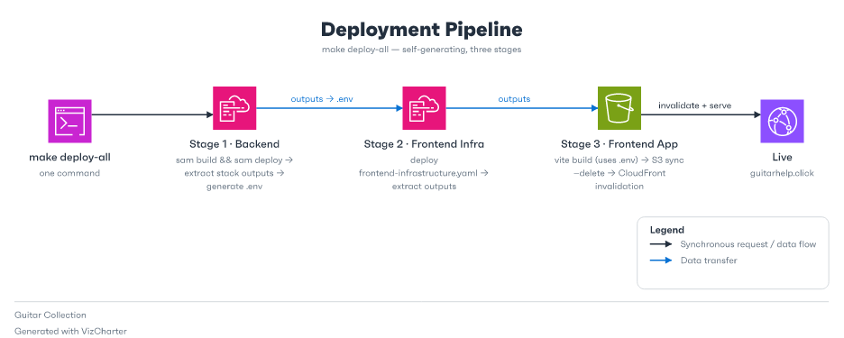

# Deployment

Deploy your own copy of the app to an AWS account. Everything runs through the root `Makefile`, which reads `.env.deploy` and `backend/samconfig.toml`.

For local development without deploying, see [DEVELOPMENT.md](DEVELOPMENT.md).

---

## Prerequisites

| Tool | Version | Notes |
|------|---------|-------|
| Node.js | 22+ (repo pins 24.11.0 in `.tool-versions`) | Lambdas run on `nodejs22.x` |
| AWS CLI | v2 | Credentials for the target account (`aws sts get-caller-identity` should work) |
| AWS SAM CLI | current | [Install guide](https://docs.aws.amazon.com/serverless-application-model/latest/developerguide/install-sam-cli.html) |
| jq | any | Parses CloudFormation outputs |
| make | any | |

You also need:

- **A domain in a Route 53 hosted zone.** The frontend stack issues an ACM certificate and points the domain at CloudFront, so it requires a hosted zone ID. The backend's custom API/images domains are optional.
- **Region `us-east-1`** (required as shipped). The frontend stack creates its CloudFront certificate in the stack's own region, and CloudFront only accepts certificates from us-east-1; the Bedrock permissions in `template.yaml` also reference US inference profiles. Other regions need template changes.
- **Amazon Bedrock model access** to **Nova Lite** (specs, receipts, document extraction) and **Nova Pro** (provenance reports) in your region. Without it, the AI features return errors; everything else works.
- **IAM permissions** to create CloudFormation stacks with named IAM roles (`CAPABILITY_NAMED_IAM`), plus Lambda, API Gateway, DynamoDB, S3, CloudFront, Cognito, SQS, SNS, ACM, and Route 53 resources.

---

## Quick start

```bash
make init        # copies .env.deploy.example → .env.deploy and samconfig.toml.example → backend/samconfig.toml
# edit both files (see Configuration below)
make install     # npm install for the frontend and backend/src
make deploy-all  # backend → frontend infrastructure → frontend app
```

The first deploy takes roughly 10–20 minutes, mostly ACM certificate validation and CloudFront distribution creation.

---

## Configuration

Both files are gitignored. Never commit them.

### `.env.deploy`

| Variable | Required | Purpose |
|----------|----------|---------|
| `AWS_ACCOUNT_ID` | yes | Checked by `make validate` |
| `AWS_REGION` | yes | e.g. `us-east-1` |
| `BACKEND_STACK_NAME` | yes | **Must equal `stack_name` in `samconfig.toml`**. Used to read stack outputs and log groups |
| `FRONTEND_BUCKET_PREFIX` | yes | Frontend stack is named `<prefix>-frontend`; bucket is `<prefix>-<account-id>` |
| `FRONTEND_DOMAIN` | yes | e.g. `example.com` |
| `HOSTED_ZONE_ID` | yes | Route 53 hosted zone ID for `FRONTEND_DOMAIN`. The frontend stack needs it for its certificate and DNS records |
| `API_DOMAIN` | no | Defaults to `api.$FRONTEND_DOMAIN`. Used in the frontend CSP |
| `IMAGES_DOMAIN` | no | Defaults to `images.$FRONTEND_DOMAIN`. Used in the frontend CSP |
| `AWS_PROFILE` | no | Exported to every `aws`/`sam` call |
| `CLOUDFRONT_DISTRIBUTION_ID` | no | Only read by the legacy `scripts/deploy-frontend.sh`. `make` gets the ID from stack outputs |

### `backend/samconfig.toml`

`make deploy-backend` runs `sam deploy` with the `[default]` environment. In `[default.global.parameters]`, set `stack_name` (must equal `BACKEND_STACK_NAME`) and `region` (must equal `AWS_REGION`). Then set these in `[default.deploy.parameters]` → `parameter_overrides`:

| Parameter | Purpose |
|-----------|---------|
| `Environment` | `prod`, `staging`, or `dev`. Becomes the API stage name and part of the images bucket name |
| `AllowedOrigin` | Your frontend origin, e.g. `https://example.com` (CORS + CSRF) |
| `FrontendDomain` | Same domain, used to build share links |
| `BucketPrefix` | Images bucket becomes `<prefix>-<Environment>-<account-id>` |
| `HostedZoneId` | Optional. When set, creates `ApiDomainName` and `ImagesDomainName` with certificates and DNS records |
| `ApiDomainName`, `ImagesDomainName` | Custom domains used when `HostedZoneId` is set |

**Values that must agree across the two files:**

| `.env.deploy` | `samconfig.toml` |
|---------------|------------------|
| `BACKEND_STACK_NAME` | `stack_name` |
| `AWS_REGION` | `region` |
| `FRONTEND_DOMAIN` | `FrontendDomain`, and `AllowedOrigin` = `https://<FRONTEND_DOMAIN>` |
| `HOSTED_ZONE_ID` | `HostedZoneId` (if you use backend custom domains) |
| `API_DOMAIN`, `IMAGES_DOMAIN` | `ApiDomainName`, `ImagesDomainName` (the frontend CSP allows only these) |

The example file also has `[dev]`, `[staging]`, and `[prod]` sections for `sam deploy --config-env <env>` (`npm run deploy:<env>` in `backend/`). Each is a **separate stack**. `make` only uses `[default]`, so don't mix the two approaches for the same environment.

---

## What `make deploy-all` does



> Three stages. Each stage's CloudFormation outputs feed the next; the backend outputs generate the frontend `.env`.

| Stage | Target | What happens | Writes |
|-------|--------|--------------|--------|
| 1 | `make deploy-backend` | `sam build && sam deploy` with `backend/template.yaml`, then reads the stack outputs | `.env.backend.outputs`, `.env` |
| 2 | `make deploy-frontend-infra` | `aws cloudformation deploy` of `frontend-infrastructure.yaml` (S3, CloudFront, ACM, Route 53, security headers) | `.env.frontend.outputs` |
| 3 | `make deploy-frontend` | `npm run build`, `aws s3 sync dist/ --delete` (long cache), re-upload `index.html` with `no-cache`, CloudFront invalidation of `/*` | — |

Each target can be run on its own. After the first deploy, a typical update is `make deploy-backend` and/or `make deploy-frontend`.

### Generated files

All gitignored; regenerated on every deploy.

| File | Contents | Used by |
|------|----------|---------|
| `.env.backend.outputs` | API URL (custom domain if set), user pool and client IDs, images CloudFront domain, images bucket | `_generate-env`, `teardown`, `status` |
| `.env` | `VITE_API_URL` (the only variable the frontend reads) plus informational values | `vite build` |
| `.env.frontend.outputs` | Frontend bucket, distribution ID and domain, website URL | `deploy-frontend`, `teardown` |

`VITE_API_URL` is baked into the bundle at build time. Rebuild (`make deploy-frontend` always does) whenever the API URL changes.

### Backend stack outputs

`ApiUrl`, `CustomDomainUrl` (when a custom domain is set), `UserPoolId`, `UserPoolClientId`, `ImagesBucketName`, `CloudFrontDomain`, `ImagesCdnUrl`, table names, and `CertificateArn`. Inspect them with:

```bash
aws cloudformation describe-stacks --stack-name "$BACKEND_STACK_NAME" --query 'Stacks[0].Outputs'
```

---

## Make targets

| Target | Description |
|--------|-------------|
| `make help` | List targets |
| `make init` | Create `.env.deploy` and `backend/samconfig.toml` from the examples (won't overwrite) |
| `make init-hooks` | Enable the secret-scanning pre-commit hook (`core.hooksPath=.git-hooks`) |
| `make install` | `npm install` in the repo root and `backend/src` |
| `make validate` | Check config values and that `aws`, `sam`, `jq` are installed |
| `make status` | Show configuration and cached outputs |
| `make deploy-all` | All three stages |
| `make deploy-backend` / `deploy-frontend-infra` / `deploy-frontend` | Individual stages |
| `make build` | Frontend production build only |
| `make logs FUNC=<suffix>` | Tail `/aws/lambda/<stack>-<suffix>`. Suffixes: `auth`, `guitars`, `public-guitar`, `images`, `user`, `specs`, `receipts`, `documents`, `document-extraction`, `provenance`, `shares` |
| `make clean` | Remove `dist/`, `backend/.aws-sam/`, and the cached outputs (keeps `.env`) |
| `make teardown` | **Destructive.** Empties both buckets and deletes both stacks after you type `DELETE` |

### Dry run

Preview changes without touching the deployed environment:

```bash
cd backend && sam build && sam deploy --no-execute-changeset --no-fail-on-empty-changeset
aws s3 sync dist/ "s3://<frontend-bucket>" --delete --dryrun
```

---

## Verifying a deployment

```bash
make status
curl -s "$(grep BACKEND_API_URL .env.backend.outputs | cut -d= -f2)/public/guitars/random"   # 200 or 404 = API reachable
aws s3 cp "s3://<frontend-bucket>/index.html" - | grep -o 'index-[^"]*\.js'                 # should match dist/assets/
```

Then open your domain, register an account, and add a guitar.

---

## Teardown

```bash
make teardown
```

It empties the frontend and images buckets, deletes `<prefix>-frontend`, then runs `sam delete` on the backend stack. These may need manual cleanup:

- **The images bucket**: it is versioned, and `aws s3 rm` leaves old object versions behind, so the stack deletion can fail on it. Delete all object versions, then retry `sam delete`.
- DynamoDB tables have no retention policy, so **your data is deleted with the stack**. Export anything you want to keep first.
- CloudWatch log groups (retained by default)
- ACM certificates or Route 53 records you created outside the stacks

---

## Troubleshooting

| Symptom | Likely cause / fix |
|---------|-------------------|
| `make validate` fails | A required `.env.deploy` variable is missing, or `aws`/`sam`/`jq` isn't on `PATH` |
| `Cannot find module …` in Lambda logs | Dependency missing from `backend/src/package.json`, or `make install` wasn't run before `sam build` |
| Frontend stack stuck in `CREATE_IN_PROGRESS` | ACM DNS validation is waiting; check that `HOSTED_ZONE_ID` is the zone for `FRONTEND_DOMAIN` |
| Browser CORS errors | `AllowedOrigin` in `samconfig.toml` doesn't exactly match the site origin (scheme + host, no trailing slash) |
| 403 `Missing required security header` / `Missing Origin header` | Request didn't go through `src/utils/api.ts`, or it came from an origin other than `AllowedOrigin` |
| 400 on save with an unknown field | Field not in `ALLOWED_GUITAR_FIELDS` (`backend/src/lib/validation.js`) |
| AI import returns 500 | Bedrock model access not enabled for Nova Lite/Pro in the region; check `make logs FUNC=specs` |
| Site shows old version | `index.html` cached. `make deploy-frontend` re-uploads it with `no-cache` and invalidates `/*`; wait for the invalidation to complete |

---

## Costs

Pay-per-use. A personal deployment with light traffic typically costs a few dollars a month. CloudFront, S3 storage, and DynamoDB (on-demand billing; point-in-time recovery is enabled when `Environment=prod`) dominate; Lambda and Cognito usually stay in the free tier. AI calls are per request (fractions of a cent each; Textract bills per page). Use the [AWS Pricing Calculator](https://calculator.aws/) for your expected usage.

---

## Legacy scripts

`scripts/*.sh`, `deploy-frontend-infra.sh`, and `backend/scripts/*.sh` predate the Makefile and use hard-coded stack names that differ from it. Prefer the `make` targets.
